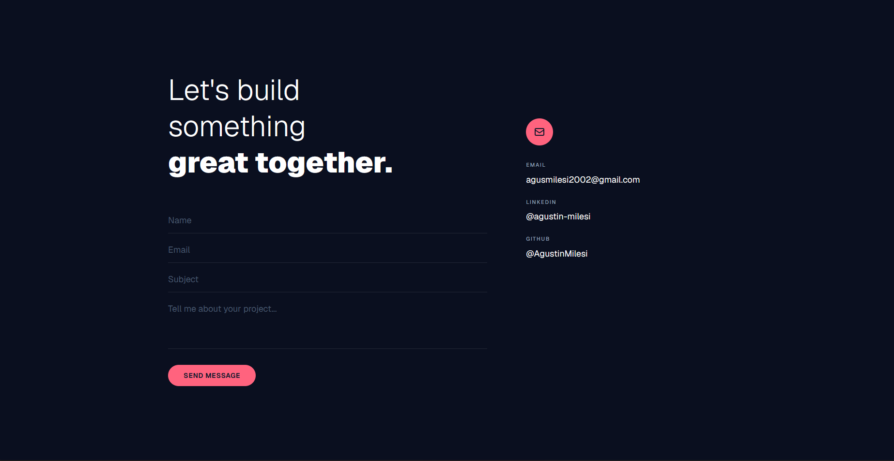

# Contact Page

A contact form built with Next.js. It validates on both the client and the server, saves every message in PostgreSQL and sends it to my inbox through Resend.

Live demo: [agustinmilesi-contact.vercel.app](https://agustinmilesi-contact.vercel.app)

## What it does

- Validates with Zod in the browser and again on the server, using one shared schema
- Stores messages in PostgreSQL (Neon) through Prisma
- Emails each message with Resend, with the visitor's address set as reply-to
- Escapes everything the visitor writes before putting it in the email
- Hidden honeypot field to filter out basic spam bots
- Toast feedback with Sonner, responsive layout, dark UI built with Tailwind CSS

## Stack

| Layer | Tech |
|-------|------|
| Framework | Next.js 16 (App Router) |
| Language | TypeScript |
| Styling | Tailwind CSS |
| Forms | React Hook Form + Zod |
| Database | PostgreSQL (Neon) + Prisma |
| Emails | Resend |
| Notifications | Sonner |
| Deploy | Vercel |

## Running it locally

    git clone https://github.com/AgustinMilesi/contact-page.git
    cd contact-page
    npm install
    cp .env.example .env
    npx prisma migrate dev
    npm run dev

Then fill in `.env`:

    DATABASE_URL="postgresql://..."
    RESEND_API_KEY="re_your_api_key"
    CONTACT_EMAIL="your@email.com"

## License

MIT